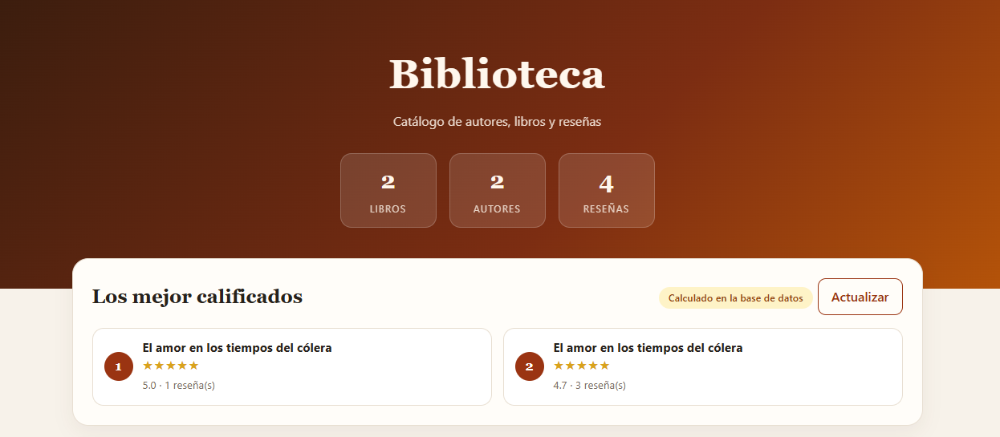
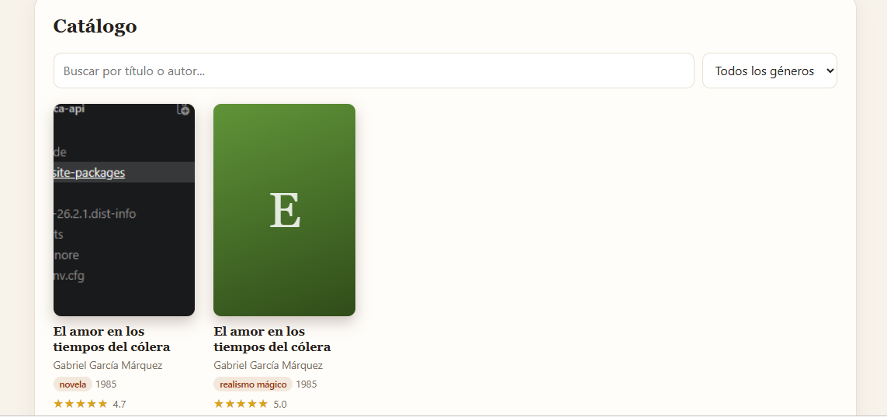
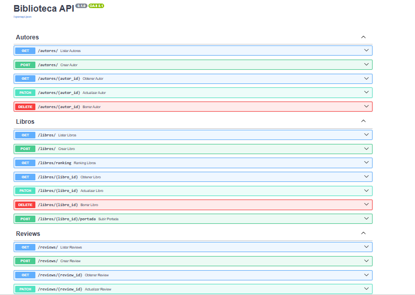
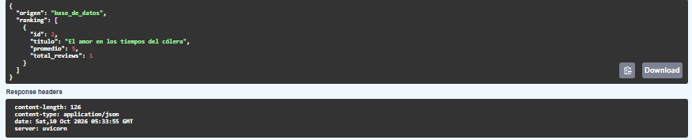
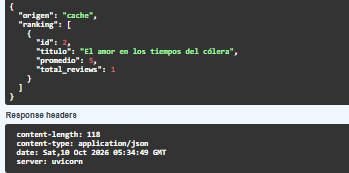
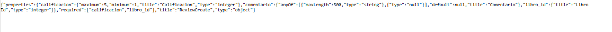
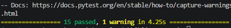
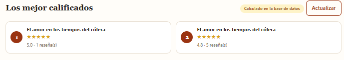
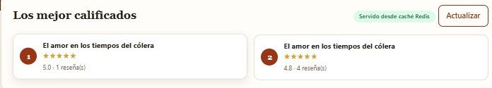

# 📚 Biblioteca API

API REST para gestionar una biblioteca: autores, libros y reseñas. Desarrollada con **FastAPI** y **SQLModel**, con base de datos **SQLite**, caché en **Redis**, subida de portadas y pruebas automatizadas con **pytest**.

**Autor:** [Tu nombre]

## 🎯 Descripción del dominio

El sistema modela el catálogo de una biblioteca con tres entidades relacionadas:

- **Autor** (nombre, país, biografía): un autor tiene muchos libros.
- **Libro** (título, año, género, portada): pertenece a un autor y tiene muchas reseñas.
- **Review** (calificación de 1 a 5, comentario): pertenece a un libro.

Relaciones: `Autor 1 → N Libro 1 → N Review`.

Con eso la API permite administrar el catálogo, calificar libros, ver un **ranking de los mejor calificados** (consulta pesada cacheada en Redis) y subir la **portada** de cada libro.

## 🧰 Tecnologías

- Python 3.13 o superior
- FastAPI + Uvicorn
- SQLModel (SQLite)
- Redis (caché del ranking)
- Pytest + HTTPX (pruebas)

## 📁 Estructura

```
biblioteca-api/
├── app/
│   ├── main.py          # aplicación, archivos estáticos y JSON Schema
│   ├── database.py      # conexión a la base de datos
│   ├── models.py        # modelos y validaciones
│   ├── cache.py         # funciones de Redis
│   ├── routers/         # autores, libros y reviews
│   └── static/portadas/ # imágenes subidas
├── tests/test_api.py
├── pytest.ini
└── requirements.txt
```

## ⚙️ Instalación

1. Clona el repositorio y entra a la carpeta:

```bash
git clone https://github.com/<tu-usuario>/biblioteca-api.git
cd biblioteca-api
```

2. Crea y activa un entorno virtual:

```bash
python -m venv venv
venv\Scripts\activate          # Windows
source venv/bin/activate       # Mac / Linux
```

3. Instala las dependencias:

```bash
pip install -r requirements.txt
```

## 🔴 Cómo levantar Redis

Redis guarda en caché el ranking de libros. Elige **una** opción:

**Opción A: Docker (recomendada)**

```bash
docker run -d --name redis-biblioteca -p 6379:6379 redis
docker ps
```

**Opción B: Windows sin Docker (Memurai)**

Instala la edición gratuita para desarrolladores desde [memurai.com](https://www.memurai.com). Se instala como servicio de Windows y escucha en el puerto 6379.

**Opción C: WSL / Linux**

```bash
sudo apt install redis-server
sudo service redis-server start
```

Para comprobar que Redis responde:

```bash
python -c "import redis; print(redis.Redis().ping())"
```

Debe imprimir `True`. Si Redis está apagado la API sigue funcionando, solo que sin caché.

## ▶️ Ejecutar la API

```bash
uvicorn app.main:app --reload
```

- API: http://127.0.0.1:8000
- Documentación interactiva (Swagger): http://127.0.0.1:8000/docs

La base de datos `biblioteca.db` se crea sola al iniciar.

## 🧪 Pruebas

```bash
pytest -v
```

Las pruebas usan una base de datos temporal en memoria y una caché simulada, por lo que no necesitan Redis encendido ni modifican `biblioteca.db`.

## 🔗 Endpoints

| Recurso | Método | Ruta | Descripción |
|---|---|---|---|
| Autores | GET | `/autores/` | Lista de autores |
| | GET | `/autores/{id}` | Detalle de un autor |
| | POST | `/autores/` | Crear autor |
| | PATCH | `/autores/{id}` | Editar autor |
| | DELETE | `/autores/{id}` | Borrar autor (no si tiene libros) |
| Libros | GET | `/libros/` | Lista con filtros `genero`, `autor_id` y paginación `limit`, `offset` |
| | GET | `/libros/ranking` | Ranking por promedio de reviews (con caché Redis) |
| | GET | `/libros/{id}` | Detalle de un libro |
| | POST | `/libros/` | Crear libro |
| | PATCH | `/libros/{id}` | Editar libro |
| | DELETE | `/libros/{id}` | Borrar libro y sus reviews |
| | POST | `/libros/{id}/portada` | Subir imagen de portada |
| Reviews | GET | `/reviews/` | Lista (filtro `libro_id`) |
| | GET | `/reviews/{id}` | Detalle de una review |
| | POST | `/reviews/` | Crear review |
| | PATCH | `/reviews/{id}` | Editar review |
| | DELETE | `/reviews/{id}` | Borrar review |
| Schema | GET | `/schemas/{autor\|libro\|review}` | JSON Schema del modelo |
| Estáticos | GET | `/static/portadas/{archivo}` | Imagen de portada |

## 💡 Ejemplos de uso (curl)

> En Windows PowerShell usa `curl.exe` en lugar de `curl`. También puedes probar todo desde `/docs`.

Crear un autor:

```bash
curl -X POST http://127.0.0.1:8000/autores/ \
  -H "Content-Type: application/json" \
  -d '{"nombre": "Gabriel García Márquez", "pais": "Colombia"}'
```

Crear un libro:

```bash
curl -X POST http://127.0.0.1:8000/libros/ \
  -H "Content-Type: application/json" \
  -d '{"titulo": "Cien años de soledad", "anio": 1967, "genero": "novela", "autor_id": 1}'
```

Crear una review:

```bash
curl -X POST http://127.0.0.1:8000/reviews/ \
  -H "Content-Type: application/json" \
  -d '{"calificacion": 5, "comentario": "Una obra maestra", "libro_id": 1}'
```

Ver el ranking (la primera respuesta trae `"origen": "base_de_datos"`, las siguientes `"cache"`):

```bash
curl http://127.0.0.1:8000/libros/ranking?limite=5
```

Subir una portada:

```bash
curl -X POST http://127.0.0.1:8000/libros/1/portada \
  -F "archivo=@portada.jpg;type=image/jpeg"
```

Ver el JSON Schema de una review:

```bash
curl http://127.0.0.1:8000/schemas/review
```

## ✅ Validaciones y errores

| Caso | Código |
|---|---|
| Campo inválido (nombre de 1 letra, calificación fuera de 1 a 5, año fuera de rango) | 422 |
| Recurso no encontrado | 404 |
| Autor o libro indicado no existe | 400 |
| Borrar un autor que tiene libros | 400 |
| Archivo que no es JPG, PNG o WEBP | 400 |
| Imagen mayor a 2 MB | 413 |

Los límites se definen con `Field(...)` de Pydantic en `models.py`, y el endpoint `/schemas/{nombre}` los expone como **JSON Schema** (por ejemplo, `minimum: 1` y `maximum: 5` para la calificación).

## ⚡ Caché con Redis

`GET /libros/ranking` calcula el promedio de calificaciones de cada libro, que es la consulta más pesada. El resultado se guarda en Redis por **60 segundos**. Al crear, editar o borrar una review (o editar/borrar un libro) la caché se invalida automáticamente para que el ranking nunca quede desactualizado.
@'

### Catálogo web
Además de la API, el proyecto incluye una interfaz web en `http://127.0.0.1:8000/catalogo` que muestra el catálogo con portadas, el ranking (indicando si viene de la caché de Redis), búsqueda por título o autor, filtro por género y reseñas por libro.




'@ | Add-Content -Path README.md -Encoding utf8
## Capturas de la API y las pruebas

### Documentación interactiva (Swagger)


### Ranking calculado en la base de datos


### Ranking servido desde la caché de Redis


### JSON Schema


### Pruebas automatizadas con pytest


### Catálogo web: ranking calculado en la base de datos


### Catálogo web: ranking servido desde la caché de Redis


